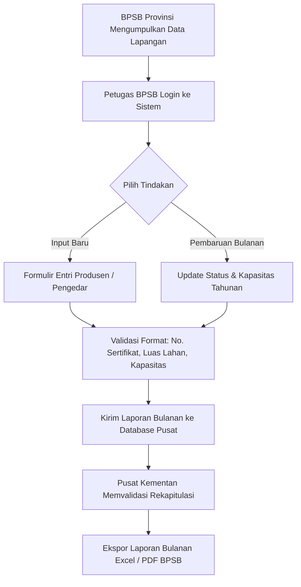
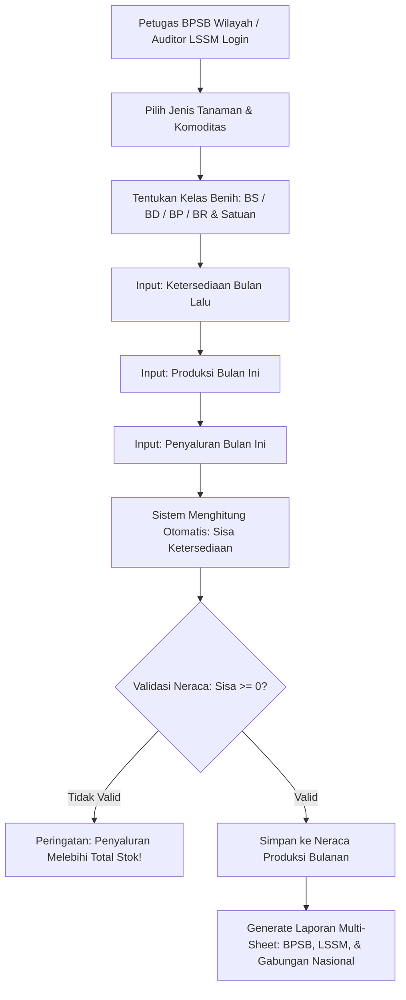
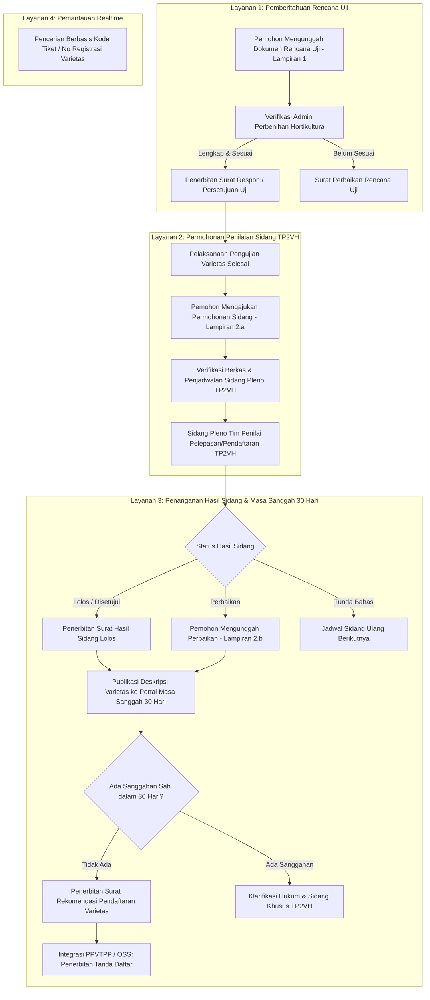

# DOKUMENTASI WORKFLOW & PROSES BISNIS SISTEM
## SIM-BENIH HORTI (SISTEM INFORMASI MANAJEMEN PERBENIHAN HORTIKULTURA)
### DIREKTORAT PERBENIHAN HORTIKULTURA — KEMENTERIAN PERTANIAN RI

Dokumen ini memetakan seluruh alur kerja operasional (*business workflow*), hak akses peran (*Role-Based Access Control*), dan aturan kalkulasi matematis yang diterapkan pada sistem **SIM-BENIH HORTI** berdasarkan berkas proses bisnis resmi Kementerian Pertanian Republik Indonesia.

---

## DAFTAR MODUL UTAMA
1. **MODUL A:** Alur Pelaporan Data Produsen dan Pengedar Benih Hortikultura (BPSB 38 Provinsi)
2. **MODUL B:** Alur Pelaporan Neraca Data Produksi Benih Bulanan (BPSB & LSSM)
3. **MODUL C:** Alur Pendaftaran Varietas Tanaman Hortikultura (Permentan No. 24 Tahun 2025)

---

## 1. MODUL A: ALUR PELAPORAN DATA PRODUSEN & PENGEDAR BENIH
Mengacu pada berkas `alur sistem pelaporan data produsen dan Pengedar.xlsx`.

### Atribut Data Wajib Modul A:
- **Identitas Wilayah:** Provinsi (Master 38 Provinsi), Kabupaten/Kota, Alamat Kantor / Kebun Benih.
- **Identitas Lembaga Usaha:** Nama Kelompok Tani / PT / CV / UPBS, Nama Pemilik/Pimpinan, Kontak (Telepon/HP/Email).
- **Peran Usaha:** `Produsen` atau `Pengedar`.
- **Sertifikasi & Legalitas:** Nomor Sertifikat Kompetensi, Tanggal Berlaku, Lembaga Penerbit.
- **Data Produksi:** Komoditas Hortikultura (Cabai, Tomat, Melon, dll.), Varietas yang diproduksi, Luas Lahan Aktif (Hektar), Kapasitas Produksi per Tahun (Kg / Batang).
- **Status Pengajuan:** `Pengajuan Baru` atau `Perpanjangan`.

---

## 2. MODUL B: ALUR NERACA DATA PRODUKSI BENIH BULANAN
Mengacu pada berkas `alur sistem pelaporan data produksi benih.xlsx`.

### Rumus Perhitungan Neraca Stok Otomatis:
$$\text{Total Ketersediaan} = \text{Ketersediaan Bulan Lalu} + \text{Produksi Bulan Ini}$$
$$\text{Sisa Ketersediaan Bulan Ini} = \text{Total Ketersediaan} - \text{Penyaluran Bulan Ini}$$

### Master Klasifikasi Tanaman & Satuan:
1. **Tanaman Sayuran:** Mentimun, Buncis, Cabai Besar, Cabai Rawit, Tomat, Bawang Merah, Kangkung, Sawi, dll. Satuan: `Kg`, `Knol` (khusus benih kentang G0-G2).
2. **Tanaman Buah:** Melon, Semangka, Alpukat, Mangga, Rambutan, Durian, Jeruk, Pisang, dll. Satuan: `Batang`, `Kg`, `Anakan`.
3. **Tanaman Hias:** Krisan, Anggrek, Mawar, Aglaonema, dll. Satuan: `Batang`, `Planlet / Stek` (Kultur Jaringan).
4. **Tanaman Obat (Biofarmaka):** Jahe, Kunyit, Temulawak, Lengkuas, Kencur, dll. Satuan: `Kg`, `Rimpang`.

---

## 3. MODUL C: PENDAFTARAN VARIETAS TANAMAN HORTIKULTURA (PERMENTAN 24/2025)
Mengacu pada berkas `Bisnis Proses Pendaftaran Varietas Tanaman Hortikultura.pptx`.

---

## 4. MATRIKS HAK AKSES PERAN (ROLE-BASED ACCESS CONTROL)

| Fitur / Halaman | Super Admin Pusat | Tim Penilai TP2VH | Petugas BPSB | Auditor LSSM | Pemohon / Produsen | Publik / Tamu |
| :--- | :---: | :---: | :---: | :---: | :---: | :---: |
| **Katalog Varietas Terdaftar** | Akses Penuh | Akses Penuh | Lihat Saja | Lihat Saja | Lihat Saja | Lihat Saja |
| **Portal Masa Sanggah (30 Hari)** | Kelola & Review | Review Teknis | Lihat Saja | Lihat Saja | Ajukan Sanggah | Pantau & Ajukan |
| **Lacak Tiket Permohonan** | Akses Penuh | Akses Penuh | Lihat Saja | Lihat Saja | Lacak Mandiri | Lacak Mandiri |
| **Pelaporan Produsen/Pengedar** | Verifikasi Nasional | Tidak | Input Wilayah | Tidak | Profil Sendiri | Tidak |
| **Pelaporan Neraca Benih** | Rekap Nasional | Tidak | Input BPSB | Input LSSM | Tidak | Tidak |
| **Pemberitahuan Rencana Uji** | Verifikasi & Surat | Tidak | Tidak | Tidak | Ajukan Dokumen | Tidak |
| **Sidang Pleno TP2VH** | Atur Jadwal | Input Nilai/Status | Tidak | Tidak | Pantau Status | Tidak |
| **Export Excel Multi-Sheet** | Ya (Nasional) | Ya (Varietas) | Ya (Wilayah) | Ya (Wilayah) | Tidak | Tidak |

---

## 5. STRUKTUR SHEET PADA EXPORT MULTI-SHEET LAPORAN PRODUKSI
Sesuai format resmi Kementan RI, berkas Excel hasil export terdiri dari lembar kerja (*sheets*):
1. `Sheet 1 - Rekapitulasi BPSB`: Laporan bulanan per kab/kota di provinsi terkait.
2. `Sheet 2 - Rekapitulasi LSSM`: Laporan audit mutu produsen berlabel mutu.
3. `Sheet 3 - Neraca Tanaman Sayuran`: Data ketersediaan, produksi, penyaluran benih sayur.
4. `Sheet 4 - Neraca Tanaman Buah`: Data batang dan bibit tanaman buah tahunan.
5. `Sheet 5 - Neraca Tanaman Hias`: Data planlet kultur jaringan dan stek bunga.
6. `Sheet 6 - Neraca Tanaman Obat`: Data rimpang biofarmaka nasional.
